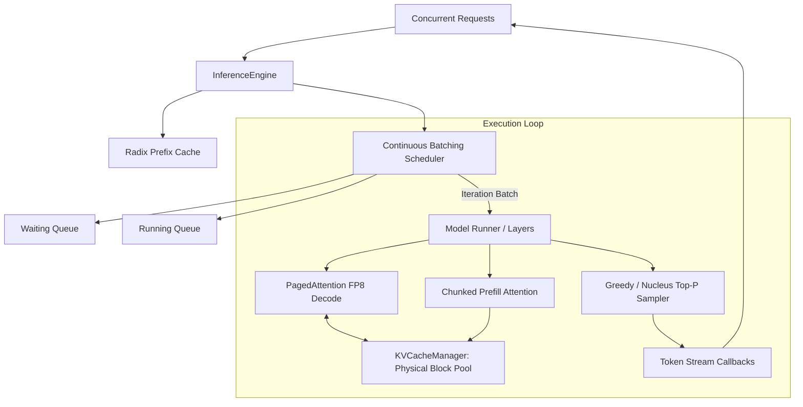

# TensorLite: High-Performance Educational C++20 / CUDA LLM Inference Engine

**TensorLite** is a production-grade, educational C++20/CUDA LLM inference runtime and engine inspired by the core architectures of **vLLM** and **SGLang**. It teaches students, engineers, and researchers how modern production LLM serving systems achieve high throughput, zero-waste memory management, and low latency.

---

## 🌟 Key Features

- **PagedAttention Virtual Memory**: Eliminates KV cache fragmentation by allocating memory in fixed-size physical blocks with per-sequence page tables.
- **FP8 (E4M3) Quantized KV Cache & Weights**: Halves memory footprint and memory bandwidth bottlenecks with on-the-fly FP8 dequantization.
- **Continuous (Iteration-Level) Batching**: Dynamic sequence admission, preemption, and completion without head-of-line blocking.
- **Chunked Prefill**: Breaks long prompt prefill computations into token-budgeted chunks to preserve decoding token latency.
- **Radix-Tree Prefix Caching**: Matches and reuses identical prompt prefixes across requests with Copy-On-Write (COW) semantics and reference counting.
- **Streaming Responses**: Real-time asynchronous token callbacks for low-latency client delivery.
- **Dual-Backend (Pure Modern C++20 & Native CUDA 12+)**: Runs anywhere—compiles and runs on CPU development environments/CI without GPUs, while providing native CUDA kernels for NVIDIA GPUs.

---

## 📚 Educational Learning Path (Modules 0 through 10)

TensorLite is structured into 11 progressive, self-contained educational modules. Each module contains comprehensive theory, Mermaid diagrams, design trade-off justifications, code walkthroughs, and a dedicated unit test:

| Module | Topic | Documentation | Tests / Source |
| :--- | :--- | :--- | :--- |
| **Module 0** | Project Skeleton & Build System | [`docs/module_00_skeleton.md`](docs/module_00_skeleton.md) | `tests/test_module_0.cpp` |
| **Module 1** | Tensor & Memory Primitives (RAII) | [`docs/module_01_tensor_memory.md`](docs/module_01_tensor_memory.md) | `tests/test_module_1.cpp` |
| **Module 2** | Model Loading (FP8 Safetensors) | [`docs/module_02_model_loader.md`](docs/module_02_model_loader.md) | `tests/test_module_2.cpp` |
| **Module 3** | Tokenizer & Request Representation | [`docs/module_03_tokenizer_request.md`](docs/module_03_tokenizer_request.md) | `tests/test_module_3.cpp` |
| **Module 4** | KV Cache Manager & Block Tables | [`docs/module_04_kv_cache_manager.md`](docs/module_04_kv_cache_manager.md) | `tests/test_module_4.cpp` |
| **Module 5** | PagedAttention Kernels (FP8 Dequant) | [`docs/module_05_attention_kernels.md`](docs/module_05_attention_kernels.md) | `tests/test_module_5.cpp` |
| **Module 6** | Transformer Layer & Forward (Qwen) | [`docs/module_06_transformer_forward.md`](docs/module_06_transformer_forward.md) | `tests/test_module_6.cpp` |
| **Module 7** | Scheduler & Continuous Batching | [`docs/module_07_scheduler.md`](docs/module_07_scheduler.md) | `tests/test_module_7.cpp` |
| **Module 8** | Prefix Cache / Radix Reuse | [`docs/module_08_prefix_cache.md`](docs/module_08_prefix_cache.md) | `tests/test_module_8.cpp` |
| **Module 9** | Engine Loop & Token Streaming | [`docs/module_09_engine_loop.md`](docs/module_09_engine_loop.md) | `tests/test_module_9.cpp` |
| **Module 10**| Integration, Tests & Final CLI | [`docs/module_10_integration.md`](docs/module_10_integration.md) | `tests/test_module_10.cpp` |

---

## 🏗️ Architecture Overview



---

## 🚀 Quickstart: Build and Run

### 1. Requirements
- CMake 3.20+
- Modern C++ compiler supporting C++20 (`g++-12+` or `clang-16+`)
- Python 3.8+ (for synthetic model generator)
- *(Optional)* NVIDIA GPU with CUDA 12+ and `nvcc` for native GPU execution.

### 2. Build the Project
```bash
# Clone and enter repo
cd TensorLite

# Create build directory
mkdir -p build && cd build

# Configure build (defaults to CPU SIMD simulation; pass -DTENSORLITE_ENABLE_CUDA=ON on GPU machines)
cmake .. -DTENSORLITE_ENABLE_CUDA=OFF

# Build runtime, CLI, and test suite in one command
cmake --build .
```

### 3. Generate Synthetic FP8 Model (Zero Download)
Generate a tiny valid FP8 Qwen-style checkpoint:
```bash
python3 ../scripts/create_test_model.py ../models/test_qwen_fp8
```

### 4. Run All Unit & Integration Tests
```bash
ctest --output-on-failure
```
Every single module (from Module 0 through Module 10) will run and pass!

### 5. Launch the TensorLite Interactive Server / CLI
```bash
./tensorlite_cli ../models/test_qwen_fp8
```

You will observe:
1. Fast FP8 weights loading and memory mapping.
2. Concurrent multi-prompt intake.
3. Continuous batching with interleaved token streaming.
4. Prefix cache hitting and reusing prefill blocks across requests!

---

## 📄 License
This project is released under the Apache 2.0 License.
