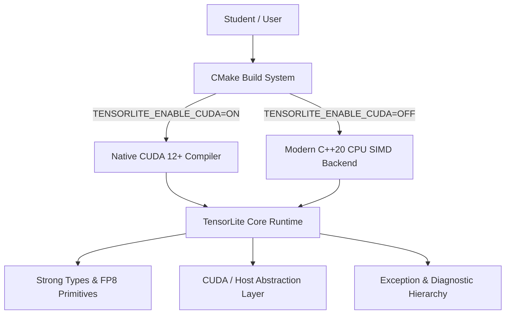

# Module 0: Project Skeleton, Types, and Build System

Welcome to **TensorLite**! In this module, we establish the foundation of our high-performance LLM inference engine.

## 1. Why Modern C++20 and Dual-Backend Design?

In production inference runtimes like **vLLM** and **SGLang**, system predictability, zero-cost abstractions, and strict memory safety are paramount:
- **Type Safety Without Overhead**: Using raw integers (`int64_t`) for sequence IDs, block IDs, and request IDs is a common source of catastrophic bugs (e.g., passing a `block_id` where a `seq_id` was expected). We introduce compile-time `StrongType` wrappers.
- **FP8 (E4M3) Primitives**: Modern hardware (NVIDIA Ada Lovelace, Hopper, Blackwell) executes FP8 tensor operations at double the throughput of FP16. We define bitwise conversion rules for IEEE/OCP FP8 E4M3 (1 sign bit, 4 exponent bits, 3 mantissa bits).
- **Dual CUDA / Host Execution**: A robust educational engine must compile and run on developer laptops and CI systems without physical GPUs, while retaining 100% compatibility with native CUDA 12+ and `nvcc`.

## 2. Architecture & Data Flow



## 3. Code Walkthrough

### 3.1 Strong Types (`include/tensorlite/core/types.hpp`)
We wrap underlying numeric types in compile-time distinct structs:
```cpp
template <typename Tag, typename T = int64_t>
struct StrongType {
    T value{};
    constexpr StrongType() = default;
    constexpr explicit StrongType(T val) : value(val) {}
    [[nodiscard]] constexpr T get() const noexcept { return value; }
    constexpr auto operator<=>(const StrongType&) const = default;
};
```
*Why?* This eliminates bugs without adding a single byte of memory overhead or runtime penalty. The compiler optimizes `StrongType<Tag, int32_t>` directly into a CPU register.

### 3.2 FP8 E4M3 Representation
FP8 E4M3 format uses 1 sign bit, 4 exponent bits (bias 7), and 3 mantissa bits:
- **Range**: $[-448.0, 448.0]$
- **Subnormals**: Supported when exponent bits are all zero ($2^{-6} \times \frac{M}{8}$).
- **NaN**: Represented by bit pattern `0x7F` or `0xFF`.

### 3.3 CUDA Compatibility Layer (`include/tensorlite/core/cuda_compat.hpp`)
Provides `allocate_device`, `free_device`, and `memcpy_sync`. When native CUDA is disabled, it transparently uses 64-byte aligned host memory simulating GPU device memory.

## 4. Building and Running Tests
```bash
mkdir -p build && cd build
cmake .. -DTENSORLITE_ENABLE_CUDA=OFF
cmake --build .
ctest --output-on-failure
```
You should see:
```text
1/1 Test #1: test_module_0 ....................   Passed
```
In the next module, we build **Tensor and Memory Primitives** with strict RAII and multi-dimensional strided views!
