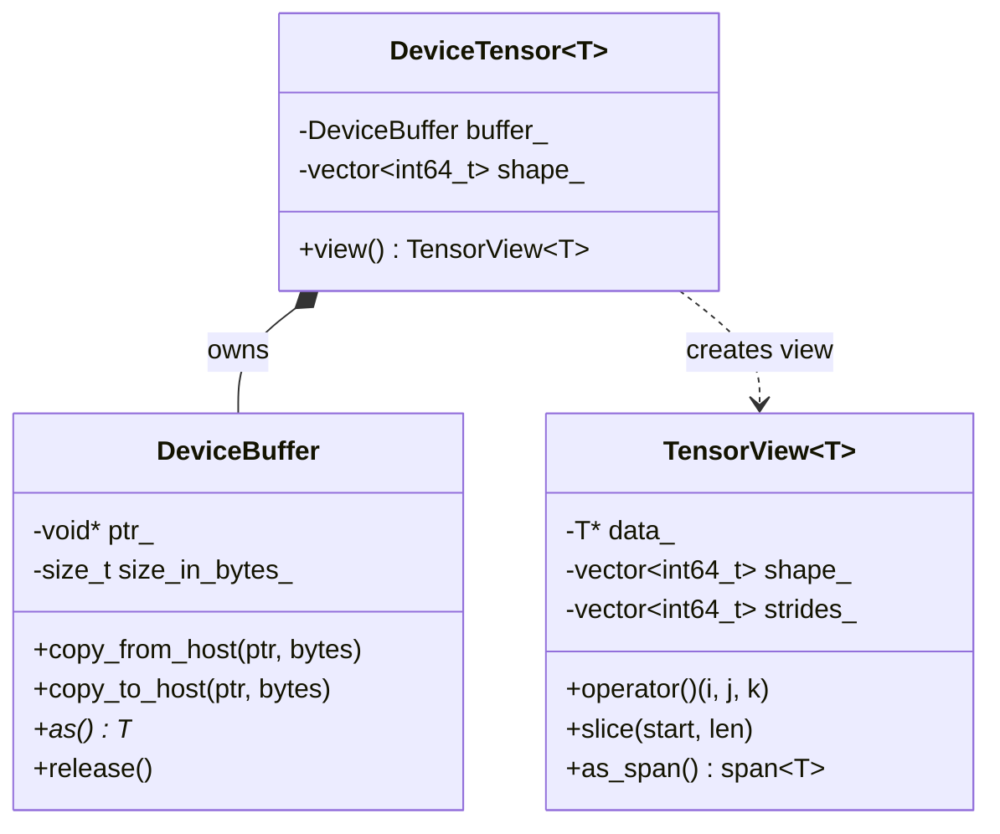

# Module 1: Tensor and Memory Primitives

Managing device and host memory in an inference runtime requires extreme rigor:
- **No Raw Pointers**: Raw `malloc`/`free` or `cudaMalloc`/`cudaFree` inevitably lead to memory leaks, use-after-free, or double-free conditions during exceptions or early exits.
- **Explicit Ownership vs Non-Owning Views**: Weight buffers and KV caches own physical memory, whereas layers, operators, and attention kernels should consume lightweight, non-owning tensor views (`TensorView`) and `std::span`.

## 1. Memory Lifetime Architecture



## 2. RAII DeviceBuffer Design (`include/tensorlite/core/device_buffer.hpp`)

`DeviceBuffer` strictly deletes copy constructors and copy assignments:
```cpp
DeviceBuffer(const DeviceBuffer&) = delete;
DeviceBuffer& operator=(const DeviceBuffer&) = delete;
```
It exclusively permits **move semantics**:
```cpp
DeviceBuffer(DeviceBuffer&& other) noexcept;
DeviceBuffer& operator=(DeviceBuffer&& other) noexcept;
```
When `DeviceBuffer` falls out of scope or an exception unwinds the stack, its destructor deterministically invokes `CudaPlatform::free_device()`.

## 3. High-Performance Strided View (`include/tensorlite/core/tensor_view.hpp`)

`TensorView<T>` allows arbitrary N-dimensional tensor indexing and slicing without copying:
$$ \text{offset} = \sum_{d=0}^{D-1} i_d \times \text{stride}_d $$
For standard row-major contiguous tensors, strides are computed backwards:
$$ \text{stride}_{D-1} = 1, \quad \text{stride}_{d} = \text{stride}_{d+1} \times \text{dim}_{d+1} $$

## 4. Verification and Tests
Run the test suite:
```bash
ctest -R test_module_1 --output-on-failure
```
Output:
```text
[PASS] DeviceBuffer RAII and move semantics verified.
[PASS] TensorView N-D indexing and slicing verified.
[PASS] DeviceTensor lifecycle verified.
```
In Module 2, we implement **FP8 Model Loading from the local Hugging Face cache (safetensors + config.json)**!
