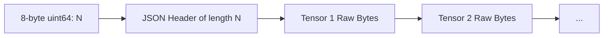
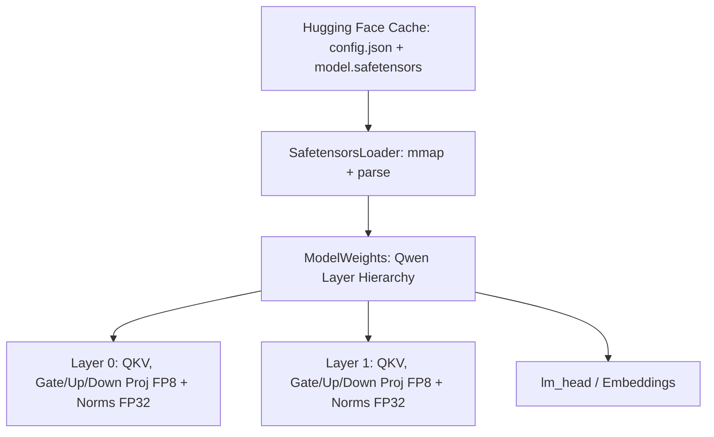

# Module 2: Model Loading (FP8 from Local Hugging Face Cache)

In production inference systems, models are downloaded directly from the Hugging Face Hub in the **safetensors** format. Safetensors is designed to prevent arbitrary code execution (unlike Python pickles) and allows zero-copy memory mapping (`mmap`).

## 1. Safetensors Binary File Layout

A `.safetensors` file consists of three contiguous segments:
1. **Header Size** (8 bytes): 64-bit unsigned little-endian integer $N$.
2. **JSON Header** ($N$ bytes): UTF-8 JSON dictionary containing metadata and tensor descriptors:
   `{ "tensor_name": { "dtype": "F8_E4M3", "shape": [64, 64], "data_offsets": [start, end] } }`
3. **Tensor Data Payloads**: Contiguous raw byte buffers.



## 2. Zero-Copy Loading & FP8 Scales

When loading FP8 models (such as Qwen 2.5 FP8 or LLaMA 3.1 FP8):
- Linear projection weights ($W_q, W_k, W_v, W_{gate}, W_{up}, W_{down}$) are stored in FP8 (E4M3), cutting model footprint in half compared to FP16.
- Accompanying scales (per-tensor or per-channel) are stored alongside weights (e.g. `*.weight_scale`).
- Mathematically, when computing matrix multiplications:
  $$ Y = X \cdot (W_{\text{fp8}} \times S_w) $$



## 3. Synthetic Model Tool (`scripts/create_test_model.py`)
Students do not need to download multi-gigabyte models to learn or test. We provide a lightweight Python script that generates a fully valid, self-contained Qwen-style FP8 safetensors model:
```bash
python3 scripts/create_test_model.py models/test_qwen_fp8
```

## 4. Verification
Run the automated test:
```bash
ctest -R test_module_2 --output-on-failure
```
Output:
```text
[PASS] ModelConfig JSON parsing verified.
[PASS] SafetensorsLoader tensor extraction & scale loading verified.
[PASS] ModelWeights full HF directory mapping verified.
```
In Module 3, we build the **Tokenizer, Request, and Sequence Abstractions**!
