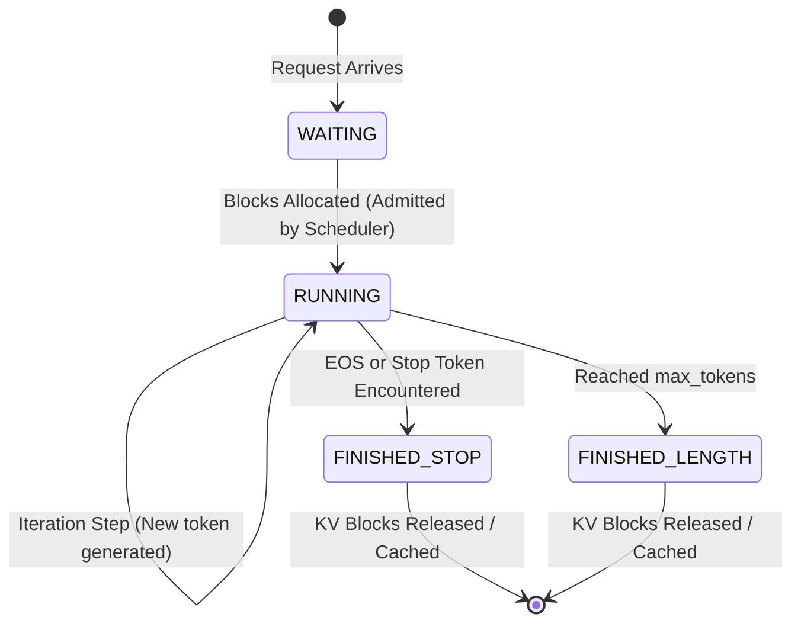

# Module 3: Tokenizer and Request Representation

An inference engine interacts with users through natural language text, but neural networks only operate on numerical token IDs. This module designs the text-to-tensor abstraction layer.

## 1. Request and Sequence State Machine

In continuous batching systems, each user prompt is encapsulated inside a `Request`, containing one or more `Sequence`s. Each sequence transitions through distinct states:



## 2. Core Concepts

### 2.1 The `Sequence` (`include/tensorlite/engine/request.hpp`)
The `Sequence` holds:
- The full token sequence (`std::vector<TokenId>`).
- `num_computed_tokens`: How many tokens have had their KV projections stored in the cache.
  - If `num_computed_tokens < prompt_len`: The sequence is in **Prefill** (or Chunked Prefill).
  - If `num_computed_tokens >= prompt_len`: The sequence is in **Decode** generating one token at a time.
- `block_table`: The sequence's page table mapping logical block $i \to$ physical `BlockId`.

### 2.2 `SamplingParams`
Defines parameters including:
- `temperature`: Temperature $\le 10^{-4}$ engages deterministic greedy argmax.
- `top_p`: Nucleus sampling threshold.
- `stop_token_ids`: Early stop triggers.

### 2.3 `Tokenizer` (`include/tensorlite/engine/tokenizer.hpp`)
Provides byte-level fallback tokenization:
- Any arbitrary UTF-8 byte stream is guaranteed to encode without out-of-vocabulary errors.
- Fast exact matching for multi-character special tokens like `<|im_start|>` and `<|im_end|>`.

## 3. Verification and Tests
Run the test suite:
```bash
ctest -R test_module_3 --output-on-failure
```
Output:
```text
[PASS] Tokenizer byte-fallback and special tokens verified.
[PASS] Sequence state and token transitions verified.
[PASS] Request sampling params and streaming callback verified.
```
In Module 4, we introduce the core innovation of modern LLM runtimes: **The KV Cache Manager and PagedAttention Data Structures**!
