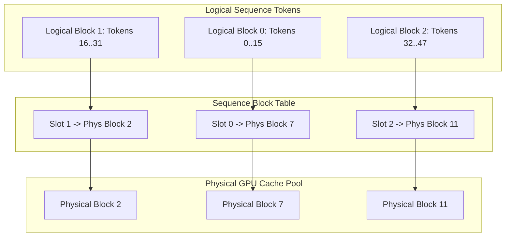
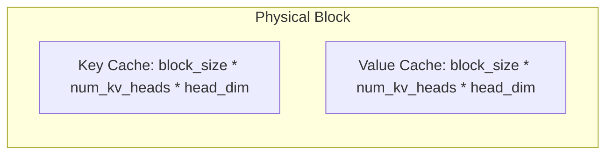

# Module 4: KV Cache Manager and PagedAttention Data Structures

In conventional Hugging Face Transformers implementations, the Key-Value (KV) cache for each sequence requires contiguous GPU memory allocated for the sequence's maximum length ($L_{max}$). This creates severe problems:
1. **Internal Fragmentation**: Allocating memory for up to 4096 tokens when only 50 are generated wastes $>90\%$ of GPU VRAM.
2. **External Fragmentation**: Dynamic sequence lengths lead to fragmented GPU heap memory.
3. **Inability to Share Memory**: Identical prompt prefixes cannot be shared across requests or parallel samples without full duplicates.

**PagedAttention** solves this by borrowing the virtual memory page table architecture from modern operating systems.

## 1. Virtual Memory Architecture: Logical Blocks $\to$ Block Table $\to$ Physical Blocks



## 2. Memory Layout of a Physical Block

Within each physical block, Key and Value vectors for $B$ tokens ($B = 16$ or $32$) are arranged for coalesced access during attention computation:



When FP8 is enabled:
$$\text{Bytes per Block per Layer} = 2 \times B \times H_{kv} \times D_{head} \times 1\text{ byte}$$
For $B=16, H_{kv}=2, D_{head}=64$:
$$\text{Bytes} = 2 \times 16 \times 2 \times 64 = 4096\text{ bytes (4 KB)}$$
Notice that 4 KB perfectly aligns with hardware memory pages and GPU warp transactions!

## 3. Reference Counting & Prefix Sharing

Each physical block tracks a `ref_count`:
- When a new sequence is allocated, `ref_count = 1`.
- When multiple requests share a common prompt prefix (Module 8: Radix Prefix Cache), `ref_count` is incremented (`retain_block`).
- When a sequence finishes, `release_block` decrements `ref_count`. Only when `ref_count == 0` does the block return to the `free_blocks_` queue.

## 4. Verification and Tests
Run the test suite:
```bash
ctest -R test_module_4 --output-on-failure
```
Output:
```text
[PASS] KVCacheManager block allocation, retain, and free verified.
[PASS] Dynamic sequence block table growth and release verified.
```
In Module 5, we write the **Attention Kernels (CUDA + Reference) supporting on-the-fly FP8 dequantization**!
