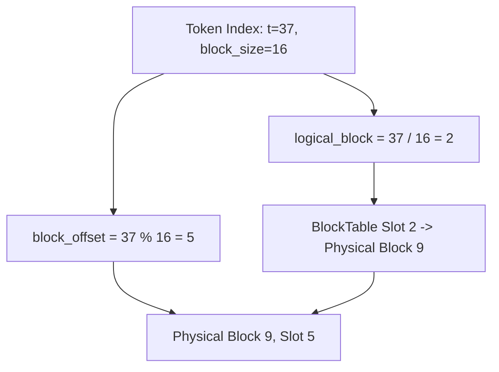

# Module 5: PagedAttention Kernels (FP8 & Dequantization)

Attention is the computational bottleneck of LLM inference. In this module, we implement the **PagedAttention kernel** that traverses non-contiguous physical blocks and dequantizes FP8 KV cache entries on the fly.

## 1. Why PagedAttention Reads Non-Contiguous Blocks

In standard contiguous attention, token keys and values are located at consecutive memory addresses:
$$\text{offset}(t) = t \times \text{stride}$$
In PagedAttention, token $t$ lives inside a physical block identified via the sequence's block table:
$$\text{logical\_block} = \lfloor t / \text{block\_size} \rfloor$$
$$\text{block\_offset} = t \pmod{\text{block\_size}}$$
$$\text{physical\_block} = \text{block\_table}[\text{seq\_id}][\text{logical\_block}]$$
$$\text{address} = \text{pool\_base} + \text{physical\_block} \times \text{block\_bytes} + \text{block\_offset} \times \text{token\_bytes}$$



## 2. On-the-Fly FP8 Dequantization

Storing KV cache in FP8 E4M3 halves the memory bandwidth requirement of the attention decode phase (which is memory-bandwidth bound):
- As each byte is read from global GPU/DRAM memory into cache registers, it is converted to float:
  $$ K_{t, d} = \text{fp8\_to\_float}(\text{k\_cache}[\text{idx}]) \times S_{kv} $$
- Softmax and accumulator operations are performed in FP32 precision to preserve numerical stability.

## 3. CUDA Kernel Launch Geometry & Warp Optimization

In the native CUDA implementation (`include/tensorlite/kernel/paged_attention_cuda.cuh`):
- **Grid Configuration**: `dim3 grid(num_heads, num_seqs)`
- **Block Configuration**: `dim3 block(128)` (4 warps per threadblock)
- **Shared Memory**: Stores partial dot products and maximum scores for parallel warp reductions.
- **Bank Conflict Avoidance**: Stride padding (`head_dim + 1` or 32-bit aligned structures) prevents threads within the same warp from accessing the same shared memory bank simultaneously.

## 4. Verification and Tests
Run the test suite:
```bash
ctest -R test_module_5 --output-on-failure
```
Output:
```text
[PASS] PagedAttention FP8 on-the-fly dequantization and GQA decode verified.
[PASS] Causal attention prefill verified.
```
In Module 6, we assemble the **Transformer Layer and Model Forward pass (Qwen Architecture)**!
