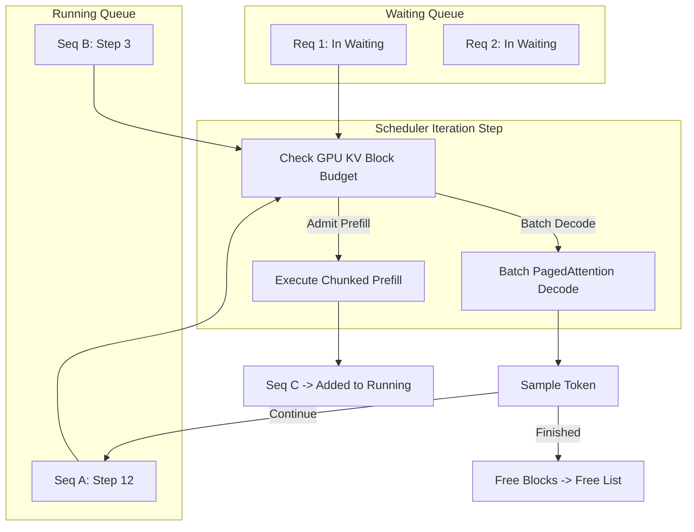

# Module 7: Scheduler and Continuous Batching

In naive batching, requests arrive and are padded together to the maximum length. New requests cannot join until the slowest request in the batch finishes (head-of-line blocking).

**Continuous Batching** (or iteration-level scheduling, pioneered by Orca and perfected in vLLM and SGLang) operates at the granularity of individual forward iterations.

## 1. Continuous Batching Iteration Cycle & State Machine



## 2. Chunked Prefill

Prompt prefilling requires $\mathcal{O}(L^2)$ computation, while token decoding requires memory-bandwidth-bound matrix-vector operations. If a 4,000-token prompt arrives, running it in a single iteration halts all decoding sequences, causing severe latency spikes (Time To Next Token / TTNT degradation).

**Chunked Prefill** divides prompt prefill into chunks bounded by `max_num_batched_tokens` (e.g. 512 tokens):
- Iteration $i$: Compute first 512 tokens of prompt + decode running sequences.
- Iteration $i+1$: Compute next 512 tokens + decode running sequences.
- Iteration $i+k$: Prompt complete $\to$ sequence transitions to decode state.

## 3. Dynamic Admission and Block Verification

Before scheduling any sequence in `schedule()`:
1. Decode sequences are checked to see if appending their next token crosses a block boundary ($L \pmod{B} == 0$). If so, an additional physical block is allocated from `KVCacheManager`.
2. Waiting sequences are admitted up to `max_num_seqs` and `max_num_batched_tokens`, provided sufficient free blocks exist.

## 4. Verification and Tests
Run the test suite:
```bash
ctest -R test_module_7 --output-on-failure
```
Output:
```text
[PASS] Continuous batching iteration schedule, prefill admission, and finish verified.
[PASS] Chunked prefill token-budget splitting verified.
```
In Module 8, we build **Prefix Caching and Radix Tree Block Reuse**!
