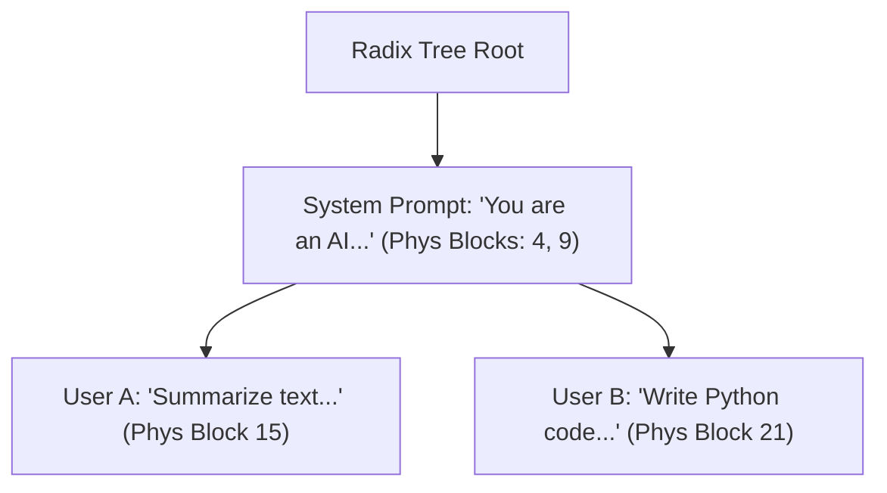

# Module 8: Prefix Cache / Radix Reuse

In real-world LLM workloads (few-shot prompting, system prompts, multi-turn chat dialogues, agent tools), different requests often share identical token prefixes:
- System prompt: `"You are a helpful assistant..."` (hundreds or thousands of tokens)
- RAG document chunks inserted at the beginning of queries

Without prefix caching, the engine must re-execute the $\mathcal{O}(L^2)$ prefill computation on these identical prefix tokens for **every single request**.

## 1. Radix Tree / Trie Architecture

**Prefix Caching** organizes token prefixes in a Radix Tree (compact Trie):
- Each tree edge stores a contiguous sequence of tokens.
- Each tree node maps those tokens to pre-computed physical `BlockId`s in the GPU cache pool.



## 2. Copy-on-Write (COW) Semantics & Reference Counting

When a new request arrives:
1. `match_prefix()` searches the Radix Tree for the longest matching token prefix.
2. The matching physical blocks are directly assigned to the new sequence's block table.
3. The reference counter of those blocks is incremented (`kv_manager_->retain_block(bid)`).
4. **Prefill Skip**: The engine skips prefilling the first $M$ matched tokens! If a 2,000-token system prompt is matched, Time-To-First-Token (TTFT) drops from hundreds of milliseconds to under 1 millisecond!
5. When the sequence later generates novel tokens, it allocates its own private blocks. If a shared block needs modification, a fresh block is allocated (Copy-On-Write).

## 3. Verification and Tests
Run the test suite:
```bash
ctest -R test_module_8 --output-on-failure
```
Output:
```text
[PASS] Radix Prefix Cache longest-prefix matching & zero-overhead block reuse verified.
```
In Module 9, we assemble the complete **Inference Engine Loop, Sampling, and Token Streaming**!
