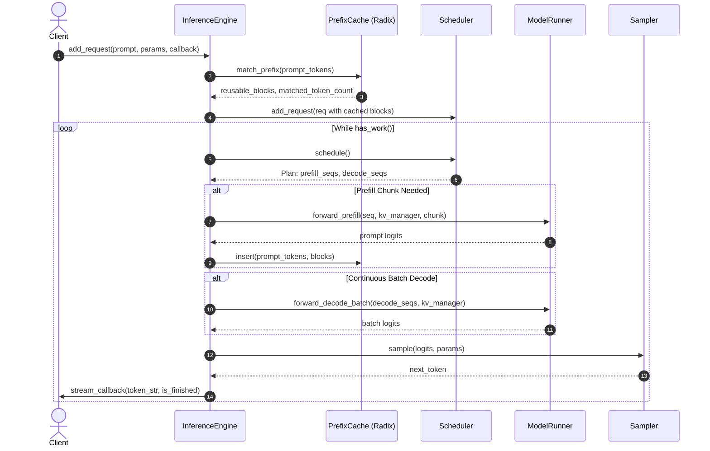

# Module 9: Engine Loop and Token Streaming

The `InferenceEngine` is the central orchestrator of TensorLite. It encapsulates model weights, the KV cache manager, the radix prefix cache, the scheduler, and the token sampler into a clean, thread-safe asynchronous engine.

## 1. Engine Architecture & Step Cycle



## 2. Token Sampling & Nucleus (Top-P) Algorithm

### 2.1 Greedy vs. Stochastic Sampling
- **Greedy Argmax**: When $\text{temperature} \le 10^{-4}$, we select $\arg\max_i (z_i)$ directly. This is deterministic and requires zero random number generation.
- **Nucleus (Top-P) Filtering**:
  Given logits $z_i$, apply temperature scaling:
  $$ \tilde{z}_i = \frac{z_i}{T} $$
  Compute the Softmax probability distribution:
  $$ P(i) = \frac{e^{\tilde{z}_i}}{\sum_j e^{\tilde{z}_j}} $$
  Sort probabilities in descending order $P_{(1)} \ge P_{(2)} \ge \dots$ and truncate at index $k$ such that:
  $$ \sum_{j=1}^k P_{(j)} \ge p $$
  Renormalize the truncated subset and draw a random sample via multinomial distribution.

## 3. Asynchronous Streaming Responses

In production environments, waiting for the full response to finish generating before returning text ruins user experience.
Each `Request` accepts a `TokenStreamCallback`:
```cpp
using TokenStreamCallback = std::function<void(const std::string& token_str, bool is_finished)>;
```
As soon as `step()` samples a token:
1. The token is appended to the sequence's history.
2. The tokenizer decodes the single token to UTF-8 text.
3. The callback is invoked immediately: `callback(token_str, false)`.
4. If an EOS token, stop string, or `max_tokens` limit is reached, `callback("", true)` is invoked, and `scheduler_->finish_sequence()` releases or recycles the physical blocks.

## 4. Verification and Tests
Run the test suite:
```bash
ctest -R test_module_9 --output-on-failure
```
Output:
```text
[PASS] Engine loop: continuous batching + token streaming verified in 6 steps!
```
In Module 10, we complete the project with **The Final CLI Executable, End-to-End Concurrent Tests, and the Master Guide**!
