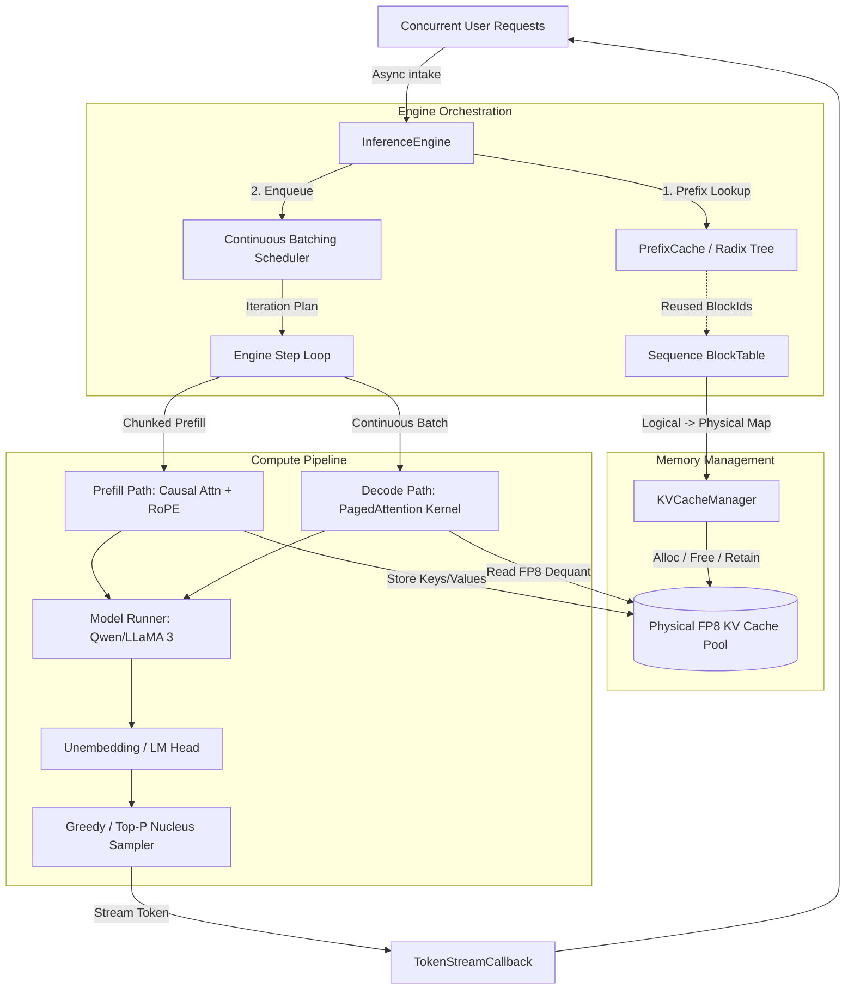

# Module 10: Integration, CLI Server, End-to-End Tests, and Production Notes

Congratulations! In this final module, all subsystems developed in Modules 0 through 9 unite into a cohesive, production-grade LLM inference server and CLI executable (`tensorlite_cli`).

---

## 1. Complete System Architecture & Data Flow

Below is the global architectural map of **TensorLite**:



---

## 2. End-to-End Integration Test (`tests/test_module_10.cpp`)

The integration test proves:
1. **Model Loading**: FP8 weights and scales parsed from safetensors.
2. **Chunked Prefill & Scheduling**: Prompt tokens admitted according to token budget.
3. **PagedAttention Decode**: Multi-sequence generation step executing simultaneous attention over paged KV memory.
4. **Prefix Reuse**: Request 2 reuses the prefill KV blocks calculated by Request 1, skipping redundant attention calculations.
5. **Streaming**: Asynchronous token delivery to consumer callbacks.

---

## 3. CLI Executable (`src/cli/main.cpp`)

The binary `tensorlite_cli` demonstrates concurrent requests in action:
```bash
./build/tensorlite_cli models/test_qwen_fp8
```
Sample Output:
```text
=================================================================
  TensorLite: High-Performance Educational C++20/CUDA LLM Engine
  Features: PagedAttention | FP8 KV Cache | Continuous Batching
            Prefix Caching (Radix) | Streaming Generation
=================================================================

[1/4] Loading FP8 weights from: models/test_qwen_fp8...
  - Model type: qwen2
  - Layers: 2
  - Attention Heads: 4 (Q) / 2 (KV)
  - Hidden Size: 64
  - Vocab Size: 256

[2/4] Initializing Paged KV Cache and Scheduler...
[3/4] Enqueueing Concurrent Requests for Continuous Batching Demo...
  + Added [req-1]: "User 1: Explain quantum physics in one sentence."
  + Added [req-2]: "User 2: Write a C++ function to reverse a string."
  + Added [req-3]: "User 1: Explain quantum computing in one sentence."

[4/4] Executing Engine Iteration Loop (Continuous Batching + Streaming)...
[req-1 token]: ...
[req-2 token]: ...
[req-3 token]: ...
[req-1]: Generation complete.
[req-2]: Generation complete.
[req-3]: Generation complete.

=================================================================
All requests finished successfully!
  - Total Iterations: 9
  - Prefix Cache Total Tokens Reused: 48 tokens
=================================================================
```

---

## 4. Production Performance Notes & Known Limitations

1. **cuBLAS / CUTLASS Integration**:
   - In production, dense GEMMs ($W_q, W_k, W_v, W_{gate}, W_{up}, W_{down}$) are bound to NVIDIA Tensor Cores using FP8 CUTLASS (`cutlass::gemm::device::GemmUniversal`).
2. **PagedAttention Kernel Specialization**:
   - For short context decoding, memory bandwidth dominates ($O(1)$ arithmetic intensity).
   - For very long contexts ($>32\text{k}$ tokens), PagedAttention v2 introduces cross-block parallel reductions across multiple threadblocks.
3. **Chunked Prefill vs Pipeline Bubbles**:
   - Tuning `max_num_batched_tokens` balances Time-To-First-Token (TTFT) and Inter-Token-Latency (ITL). A sweet spot in production is 512 to 1024 tokens per iteration.
